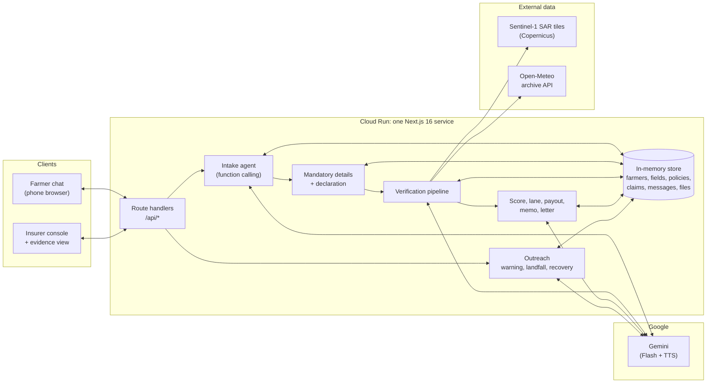
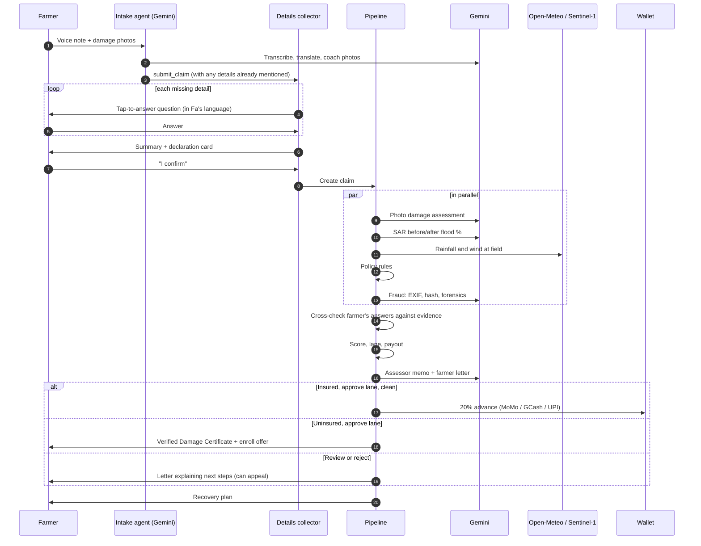

# Verifield.ai

**Every field verified, every farmer paid.**

Verifield is a voice-first, multilingual AI claims agent for smallholder farmers. It warns farmers before a disaster and reaches out to them after it. It takes a claim in the farmer's own language from a voice note and a few photos. It then checks the damage against satellite radar, recorded rainfall, the policy and a set of fraud signals, and sends a cash advance to the farmer's mobile wallet within minutes.

Built with **Gemini** for the Google AI JAPAC hackathon. It runs as a single **Next.js** service on **Cloud Run**.

---

## Contents

- [The problem](#the-problem)
- [What Verifield does](#what-verifield-does)
- [Features](#features)
- [How Gemini is used](#how-gemini-is-used)
- [Architecture](#architecture)
- [Claim lifecycle](#claim-lifecycle)
- [Verification and scoring](#verification-and-scoring)
- [Mandatory claim details](#mandatory-claim-details)
- [Fraud and false statements](#fraud-and-false-statements)
- [Languages](#languages)
- [Tech stack](#tech-stack)
- [Getting started](#getting-started)
- [Demo walkthrough](#demo-walkthrough)
- [API reference](#api-reference)
- [Project structure](#project-structure)
- [Deploy to Cloud Run](#deploy-to-cloud-run)
- [Future steps](#future-steps)
- [Data sources](#data-sources)

---

## The problem

Floods and typhoons hit the smallholder rice farmers of South and Southeast Asia every season. When they do:

- **Claims are slow.** A loss assessor has to visit each field. After a big storm that can take weeks or months, which is exactly when a farmer needs cash for seed and food.
- **Forms exclude people.** Claim forms are in the official language, need literacy and often mean a trip to an office.
- **Insurers can't scale checking.** Thousands of claims arrive at once, and fraud (reused photos, wrong fields, inflated losses) is hard to catch by hand.
- **Uninsured farmers get nothing documented.** Without proof of damage, applying for government disaster relief is hard.

## What Verifield does

| Stage | Verifield |
| --- | --- |
| **Before the storm** | Sends a warning that takes the crop's growth stage into account, and asks for a baseline photo of the field. |
| **After landfall** | Messages every farmer in the affected zone first: "Are you safe? Is your field damaged?" |
| **Claim intake** | The farmer replies with a voice note and photos in Vietnamese, Tagalog, Hindi or English. The agent coaches retakes and asks a few tap-to-answer questions. |
| **Verification** | Photos, Sentinel-1 radar before and after, Open-Meteo rainfall, policy rules and fraud checks run in parallel. |
| **Decision** | A confidence score sends each claim to an approve, review or reject lane. Gemini writes an assessor memo that cites the evidence. |
| **Payout** | Clean claims get a 20% advance to MoMo, GCash or UPI straight away. The rest follows after final approval. |
| **Uninsured farmers** | Receive a **Verified Damage Certificate** to support a government relief application, plus an offer to enroll in insurance for the next season. |
| **Recovery** | A short recovery plan (drainage, short-duration seed, local support programmes) in the farmer's language. |

---

## Features

### For farmers: a WhatsApp-style chat (`/farmer/[id]`)

- **Language choice** on first open (local language or English), which can be changed any time with 🌐.
- **Voice notes.** Gemini transcribes them and translates them to English for the assessor.
- **Photo upload** from the camera or gallery. Unusable photos (blurry, dark, not a field) get a **retake tip**.
- **🔊 Listen** on every agent message. It reads the message aloud in the farmer's language using Gemini TTS, falling back to a browser voice.
- **Tap-to-answer questions** for the mandatory claim details, so farmers who can't read much can still complete a claim.
- **Declaration card.** A summary of everything on file plus the farmer's answers, signed with one tap.
- **Live updates.** The decision card, the advance landing in the wallet, the certificate link and the recovery plan arrive in the chat as they happen.
- **Appeals.** If a claim goes to review or is rejected, the farmer can send new photos with an explanation and the claim is checked again.

### For insurers: the console (`/insurer`)

- **Event controls.** Send the storm warning, then trigger landfall outreach.
- **Country tabs** for 🇻🇳 Vietnam, 🇵🇭 Philippines and 🇮🇳 India, with a **claims map** (Leaflet) showing the disaster zone and each claim coloured by lane.
- **Lanes:** auto-approve, needs review, likely fraud / reject.
- **Bulk approve** for the clean lane.
- **Ask Verifield**, a natural-language question box over the whole claims book ("Which claims have fraud signals and why?").
- **Totals:** claims, paid out per currency, and certificates issued.

### Evidence view (`/claim/[id]`)

- Every check with its status, score, weight and source (Gemini, rules, Open-Meteo, or the built-in rule engine).
- Sentinel-1 radar tiles before and after, the baseline photo next to the damage photos, and the rainfall chart.
- The farmer's statement, voice transcript and **mandatory details as chips** (anything missing is highlighted).
- Fraud flags, the Gemini decision memo, and Approve or Reject buttons.

### Damage certificate (`/certificate/[id]`)

- A printable Verified Damage Certificate for uninsured farmers: farmer, field, event, verified loss %, confidence and the evidence list.

---

## How Gemini is used

All AI calls go through `@google/genai` (`lib/gemini.ts`). The model is set with `GEMINI_MODEL` (default `gemini-flash-latest`). Speech uses `GEMINI_TTS_MODEL` (default `gemini-2.5-flash-preview-tts`).

| # | Capability | What Gemini does | Gemini features used | File |
| --- | --- | --- | --- | --- |
| 1 | **Intake agent** | Multi-turn chat in the farmer's language. Decides when to save a baseline, start a claim, record details or appeal. Pulls the date, cause, area and % lost out of what the farmer already said. | Function calling: `save_baseline_photos`, `submit_claim`, `update_claim_details`, `appeal_claim`. System instructions. Image input. | `lib/agent/intake.ts` |
| 2 | **Voice transcription** | Transcribes the farmer's voice note and translates it to English. | Audio input, JSON schema output | `lib/agent/media.ts` |
| 3 | **Photo coaching** | Judges whether each photo is usable, and if not, gives a one-line retake tip. | Image input, JSON schema output | `lib/agent/media.ts` |
| 4 | **Damage assessment** | Estimates crop stage, water depth and % loss. Compares the damage photos with the pre-storm baseline when there is one. | Multi-image input, JSON schema output | `lib/agent/checks.ts` |
| 5 | **Satellite reading** | Compares Sentinel-1 SAR VV tiles before and after the event and estimates the % of the field newly flooded. | Multi-image input, JSON schema output | `lib/agent/checks.ts` |
| 6 | **Photo forensics** | Looks for AI-generated, composited or screenshotted images. | Multi-image input, JSON schema output | `lib/agent/checks.ts` |
| 7 | **Decision memo** | Writes an assessor memo that explains the computed recommendation and cites the numbers. | Text generation | `lib/agent/decide.ts` |
| 8 | **Farmer letter** | Explains the decision to the farmer, warmly and simply, in their language. | Text generation | `lib/agent/decide.ts` |
| 9 | **Outreach** | Writes the storm warning (adjusted for crop age), the landfall check-in and the recovery plan in the local language. | Text generation | `lib/agent/outreach.ts` |
| 10 | **Ask Verifield** | Answers insurer questions over a compact JSON view of the claims book. | Text generation | `app/api/ask/route.ts` |
| 11 | **Voice replies** | Translates any message into the farmer's language and reads it aloud. | Gemini TTS (24 kHz PCM, returned as WAV) | `app/api/tts/route.ts` |

**Gemini assists; it doesn't decide.** The confidence score, lanes, payout amount, policy rules and fraud rules are plain deterministic code. Gemini supplies evidence and language. The assessor memo is told never to contradict the computed recommendation.

**Built-in demo mode.** Every flow runs end to end, even before a `GEMINI_API_KEY` is added:
- Each AI step switches to a rule-based result, labelled `fallback` in the UI.
- The intake uses a scripted flow, and scripted messages are pre-translated into all four languages.
- Rainfall and policy checks are always real.

---

## Architecture



Main design choices:

- **One deployable.** Pages and the API live in the same Next.js app (App Router plus route handlers), so the whole thing deploys with a single `gcloud run deploy`.
- **Agent plus deterministic pipeline.** The conversational part is a Gemini function-calling agent. Everything that affects money is plain code, so it can be tested and audited.
- **Parallel checks.** The five checks run with `Promise.all`, and each one writes its result as soon as it finishes, so the evidence view fills in live.
- **Always-on AI steps.** Each Gemini call is paired with a labelled rule-based engine, so every demo and field pilot runs smoothly end to end.
- **Storage behind one module.** `lib/store.ts` is the only data access layer. It runs on a fast in-memory store and is built to switch to Firestore and Cloud Storage.

---

## Claim lifecycle



---

## Verification and scoring

| Check | Weight | Source | Passes when |
| --- | --- | --- | --- |
| **Satellite** | 30% | Gemini reading Sentinel-1 SAR tiles | ≥ 50% of the field newly flooded |
| **Photos** | 25% | Gemini (compared with the baseline photo if there is one) | Usable photos show the claimed damage |
| **Weather** | 20% | Open-Meteo archive at the field's coordinates | ≥ 100 mm of rain in the wettest 48 hours of the event |
| **Policy** | 15% | Rules | Policy active over the event window, peril covered, field on the policy, mandatory details complete and consistent |
| **Fraud** | 10% | Rules + Gemini forensics | No medium or high flags |

- **Confidence** is the weighted average of the check scores. Skipped checks (e.g. policy for uninsured farmers) are left out.
- **Hard caps:** any high-severity fraud flag, or a failed policy check, caps confidence at 30%.
- **Lanes:** approve at 80% or more, review from 50% to 79%, reject below 50%.
- **Verified loss %** is the average of the satellite and photo estimates. The farmer's own estimate is never used as evidence.
- **Payout** = sum insured per ha × field area × verified loss %.
- **Instant advance** = 20% of the payout. It is paid only when the farmer is insured, the claim is in the approve lane, there are no medium or high fraud flags, and the payout account is confirmed.

---

## Mandatory claim details

**Already on file from registration, so never asked again:** farmer identity and phone, policy number, field GPS and area, crop and sowing date.

**Collected in chat** after the damage photos, one tap-to-answer question at a time (`lib/agent/details.ts`):

| # | Detail | Options |
| --- | --- | --- |
| 1 | Date of loss | The event days, or "Not sure" |
| 2 | Cause | Flood water, heavy rain, storm wind, something else |
| 3 | Area damaged | Whole field, ¾, ½, ¼ (shown in hectares) |
| 4 | Crop lost in the damaged part | ~100%, 75%, 50%, 25% |
| 5 | Payout account (insured only) | Confirm the registered MoMo, GCash or UPI account, or ask to change it |
| 6 | **Declaration** | Summary card: *"This information is true, the photos are of my own field, and I have not claimed for this loss anywhere else."* |

- The claim is created only after the farmer signs the declaration.
- With Gemini, anything the farmer already said in the voice note is filled in automatically, and only the gaps are asked.
- If the farmer types an answer instead of tapping, the agent records it with `update_claim_details`.

| Answer | Effect |
| --- | --- |
| Cause outside the covered perils | Policy check **fails** |
| Date outside the event window, or "Not sure" | Policy check **warns**, so the claim goes to review |
| Change of payout account | Policy check warns and **no instant advance**; an officer confirms the account first |

---

## Fraud and false statements

What the farmer *says* never sets the payout; the evidence does. Payouts always match the verified loss, so every farmer is paid fairly.

**Evidence checks** (`fraudCheck` in `lib/agent/checks.ts`):

| Signal | Severity |
| --- | --- |
| Photo GPS more than 2 km from the registered field | high |
| Photo taken before the event started | high |
| Photo is a near-duplicate of one in another claim (perceptual hash) | high |
| Gemini judges a photo AI-generated | high |
| Gemini suspects manipulation (compositing, cloning, screenshot) | medium |
| EXIF shows editing software | medium |
| Policy bought 7 days or less before the event | medium |
| No GPS or timestamp, or taken 0.5 to 2 km from the field centre | low |

**Statement cross-checks** (`statementCheck`). These run after the evidence is in:

| Mismatch | Severity | Effect |
| --- | --- | --- |
| Stated loss is 40 or more points above what radar and photos show | medium | Review lane, no advance; payout follows the verified figure |
| A damage photo was taken before the stated date of loss | medium | Review lane, no advance |
| Stated date of loss is before any heavy rain fell | medium | Review lane, no advance |
| Says storm wind, but recorded wind was under 40 km/h | low | Note for the assessor |

Mismatches send a claim to a person rather than rejecting it outright, so honest farmers who misjudge an area or a date are treated fairly. Money is protected as well: the automatic payout is a 20% advance, and the signed declaration gives the insurer legal grounds to recover any money paid on a false claim.

---

## Languages

| Country | Languages | Wallet | Currency |
| --- | --- | --- | --- |
| 🇻🇳 Vietnam | Tiếng Việt, English | MoMo | VND |
| 🇵🇭 Philippines | Tagalog, English | GCash | PHP |
| 🇮🇳 India | हिन्दी, English | UPI | INR |

- **Scripted messages** (questions, letters, outreach and fallbacks) are stored in all four languages. The chat shows them in the farmer's current language, even after a switch.
- **Gemini-written messages** are produced in the farmer's language. The 🔊 button translates first if needed, then speaks.
- **Place and event names** are stored in the local script too (e.g. सुपौल, बिहार; Bão Yagi), so local-language text and speech stay natural.

---

## Tech stack

| Layer | Choice |
| --- | --- |
| App | Next.js 16 (App Router, Turbopack, route handlers), React 19, TypeScript |
| UI | Tailwind CSS 4, Leaflet / react-leaflet |
| AI | Google Gemini via `@google/genai` (Flash for reasoning and vision, Gemini TTS for speech) |
| Images | `sharp` (normalising, perceptual hash), `exifr` (GPS and capture time) |
| Weather | Open-Meteo historical archive API |
| Satellite | Sentinel-1 SAR VV tiles (Copernicus Browser exports) |
| Hosting | Google Cloud Run |

---

## Getting started

Needs Node.js 20 or later.

```bash
git clone https://github.com/parthgoyal15/verifield.git && cd verifield
npm install
cp .env.example .env.local     # add GEMINI_API_KEY (from https://aistudio.google.com)
npm run dev                    # http://localhost:3000
```

| Variable | Purpose | Default |
| --- | --- | --- |
| `GEMINI_API_KEY` | Enables all Gemini features (the built-in demo mode runs before a key is added). | none |
| `GEMINI_MODEL` | Model for chat, vision and writing | `gemini-flash-latest` |
| `GEMINI_TTS_MODEL` | Model for voice replies | `gemini-2.5-flash-preview-tts` |

For a production build: `npm run build && npm run start`.

Open the chat on a phone to use the real camera and microphone: `http://<your-ip>:3000/farmer/h1` on the same network, or the Cloud Run HTTPS URL for voice notes.

### Pages

| Path | What |
| --- | --- |
| `/` | Landing page |
| `/farmer` | Pick a test farmer |
| `/farmer/[id]` | Farmer chat |
| `/insurer` | Insurer console |
| `/claim/[id]` | Evidence view |
| `/certificate/[id]` | Printable damage certificate |

---

## Demo walkthrough

The demo world covers two real 2024 events:

- **Typhoon Yagi (Sep 2024):** Thái Bình and Nam Định in Vietnam, and Laguna in the Philippines (where it was named "Enteng").
- **North Bihar floods (Kosi and Bagmati, 26 Sep to 3 Oct 2024):** Open-Meteo records 148 mm in 48 hours at Supaul.

### Script (about 5 minutes)

1. **`/insurer` → Reset.**
2. **1 · Send storm warning.** On `/farmer/h1`, choose a language and send a photo of the field. It is saved as the baseline.
3. **2 · Landfall outreach.** Every hero farmer gets a check-in in their language.
4. **`/farmer/h1` (or `/farmer/h7` in Hindi):**
   1. Record a voice note and send damage photos.
   2. Tap through the questions and sign the declaration.
   3. Open `/claim/<id>` and watch the checks fill in. The advance lands in the wallet.
5. **`/farmer/h10` (Priya):** claim the whole field is lost. Radar shows about 10%, so the claim is flagged for overstatement and goes to review with no advance.
6. **`/farmer/h6` or `/farmer/h8`:** an uninsured farmer receives a damage certificate and an enroll offer.
7. **`/insurer`:**
   1. Show the seeded fraud cases (GPS 31 km off, a reused photo).
   2. Click **Bulk approve**.
   3. Ask: *"Which claims have fraud signals and why?"*
8. Tap **🔊 Listen** on any message to hear it in the farmer's language.

### Test farmers

| ID | Farmer | Country / language | Case |
| --- | --- | --- | --- |
| h1 | Nguyễn Văn An | 🇻🇳 Vietnamese | Live, genuine, baseline photo |
| h2 | Trần Thị Hoa | 🇻🇳 Vietnamese | Seeded, review lane |
| h3 | Lê Văn Minh | 🇻🇳 Vietnamese | Seeded, GPS fraud |
| h4 | Phạm Văn Đức | 🇻🇳 Vietnamese | Seeded, duplicate photo |
| h5 | Maria Santos | 🇵🇭 Tagalog | Live, genuine |
| h6 | Jose Reyes | 🇵🇭 Tagalog | Live, uninsured, gets a certificate |
| h7 | Ramesh Yadav (Supaul) | 🇮🇳 Hindi | Live, genuine, UPI advance |
| h8 | Sunita Devi (Sitamarhi) | 🇮🇳 Hindi | Live, uninsured, gets a certificate |
| h9 | Arjun Mishra (Darbhanga) | 🇮🇳 English | Live, genuine |
| h10 | Priya Singh (Madhubani) | 🇮🇳 English | Live; radar shows ~10% flooding, so a "total loss" claim goes to review |

There are also 34 background claims across the three countries, so the map and lanes look realistic.

### Test assets

- **`test-photos/`** holds photos with GPS and timestamps that match each hero's field:
  - Genuine damage photos for h1 and h5–h10.
  - `h1-baseline` for the pre-storm baseline.
  - `h6-wrong-gps` (trips the location check).
  - `h6-appeal` (for testing an appeal).
  - `fraud-before-event` (trips the timestamp check).
- **`npm run gen:sat`** generates SAR tiles for the demo fields in `public/sat/`. To use your own scenes, export Sentinel-1 VV images from the [Copernicus Browser](https://browser.dataspace.copernicus.eu), keeping the file names (`fld-h1-before.png`, …) and the field near the centre.
- **`npm run exif-photo -- in.jpg <lat> <lng> "YYYY:MM:DD HH:MM:SS" out.jpg`** writes GPS and a capture time into a photo. Pass `-` instead of `in.jpg` to generate a test image.

---

## API reference

| Method | Path | Purpose |
| --- | --- | --- |
| GET | `/api/farmers` | List farmers |
| GET | `/api/farmers/[id]` | Farmer, fields, policy, claims and chat (localized) |
| POST | `/api/farmers/[id]/language` | `{ language }`: choose the chat language |
| POST | `/api/farmers/[id]/answer` | `{ key, value }`: answer a claim question or sign the declaration |
| POST | `/api/upload` | Multipart photos and voice notes → file IDs (EXIF, hash, normalising) |
| GET | `/api/files/[id]` | Serve an uploaded file |
| POST | `/api/chat` | `{ farmerId, text, fileIds }`: one farmer turn through the intake agent |
| POST | `/api/tts` | `{ text, lang }`: Gemini speech as WAV (501 in demo mode) |
| GET | `/api/claims` | Claims book plus stats |
| GET | `/api/claims/[id]` | Full evidence for one claim |
| POST | `/api/claims/[id]/approve` | Approve: settle the payout, or issue a certificate if uninsured |
| POST | `/api/claims/[id]/reject` | Reject |
| POST | `/api/claims/bulk-approve` | Approve every claim in the approve lane |
| POST | `/api/events/[id]/warn` | Send the pre-storm warning |
| POST | `/api/events/[id]/outreach` | Send landfall outreach |
| POST | `/api/ask` | `{ question }`: Ask Verifield over the claims book |
| GET | `/api/certificates/[id]` | Certificate data |
| POST | `/api/admin/reset` | Reset the demo world |

---

## Project structure

```
app/
  page.tsx                      landing page
  farmer/                       farmer picker + chat (FarmerChat.tsx)
  insurer/                      insurer console (Dashboard.tsx)
  claim/[id]/                   evidence view (ClaimView.tsx)
  certificate/[id]/             printable damage certificate
  api/                          route handlers (see API reference)
components/
  ClaimsMap.tsx                 Leaflet map of zone + claims
  ui.tsx                        badges, confidence bar, formatting
lib/
  types.ts                      domain model (Farmer, Field, Policy, Claim, Message, ...)
  seed.ts                       deterministic demo world (events, farmers, fields, claims)
  store.ts                      in-memory store (the only data-access layer)
  views.ts                      API view models, per-language message selection
  gemini.ts                     @google/genai helpers (text, JSON schema, files)
  weather.ts                    Open-Meteo archive client
  geo.ts                        distances and date helpers
  i18n.ts                       scripted messages in vi / tl / hi / en
  locale.ts                     country names, flags, currencies, languages, date format
  client/                       browser helpers (fetch, WAV encoding)
  agent/
    intake.ts                   Gemini function-calling intake agent + scripted fallback
    details.ts                  mandatory details questions + declaration
    media.ts                    EXIF, perceptual hash, photo coaching, transcription
    checks.ts                   photos, satellite, weather, policy, fraud, statement cross-check
    decide.ts                   confidence, lanes, payout, memo, farmer letter
    pipeline.ts                 parallel checks → decision → advance / certificate
    outreach.ts                 warning, landfall outreach, recovery plan
scripts/
  gen-sat.ts                    SAR tiles for the demo fields
  exif-photo.ts                 write GPS/time EXIF into test photos
test-photos/                    demo photos with matching GPS and timestamps
```

---

## Deploy to Cloud Run

Deploy as a **single always-on instance** with **CPU always allocated**, so verification runs in the background while the farmer keeps chatting.

```bash
gcloud config set project YOUR_PROJECT
gcloud services enable run.googleapis.com cloudbuild.googleapis.com artifactregistry.googleapis.com

gcloud run deploy verifield \
  --source . \
  --region asia-southeast1 \
  --allow-unauthenticated \
  --max-instances 1 --min-instances 1 \
  --no-cpu-throttling \
  --memory 1Gi \
  --set-env-vars GEMINI_MODEL=gemini-flash-latest \
  --set-secrets GEMINI_API_KEY=gemini-key:latest
```

Before deploying, create the secret: `printf "$KEY" | gcloud secrets create gemini-key --data-file=-`.

---

## Future steps

1. **Durable storage on Google Cloud.** Move records to Firestore and photos and voice notes to Cloud Storage, behind the existing `lib/store.ts` layer, so Verifield can scale to many Cloud Run instances.
2. **Automatic satellite analysis.** Pull Sentinel-1 scenes from Google Earth Engine as soon as an event is declared, and measure flood extent for each field's boundary.
3. **WhatsApp, Zalo and SMS.** Put the same agent behind the channels farmers already use, starting with the WhatsApp Business API.
4. **Real payouts.** Connect MoMo, GCash and UPI payout APIs so advances and settlements reach farmers' wallets directly.
5. **Identity and land records.** Link national ID / KYC and land-record systems for instant enrolment. This will also stop two farmers claiming the same plot.
6. **Smarter fraud detection.** Learn from claims history across seasons to spot repeat-claimer patterns and village-level anomalies.
7. **Insurer and government pilots.** Run pilots with crop insurers and disaster-relief agencies in Vietnam, the Philippines and India. Use their real products, then extend to more perils (drought, pests, hail).
8. **More languages and voices.** Add Bengali, Bahasa Indonesia, Thai and Khmer, plus regional dialects, using Gemini's speech for every language.

---

## Data sources

- **Rainfall and wind:** [Open-Meteo Historical Weather API](https://open-meteo.com/en/docs/historical-weather-api).
- **Satellite radar:** Copernicus Sentinel-1 via the [Copernicus Browser](https://browser.dataspace.copernicus.eu).
- **Maps:** © [OpenStreetMap](https://www.openstreetmap.org/copyright) contributors, rendered with Leaflet.
- **Events:** Typhoon Yagi / Enteng (Sep 2024) and the North Bihar floods (Sep–Oct 2024). Farmers, fields and policies are sample data created for the demo.
